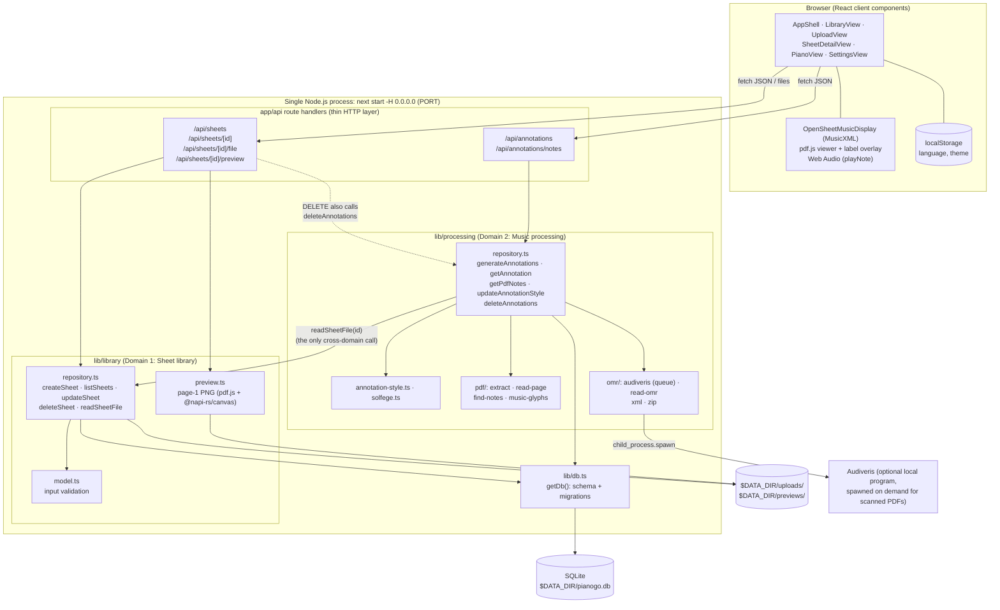
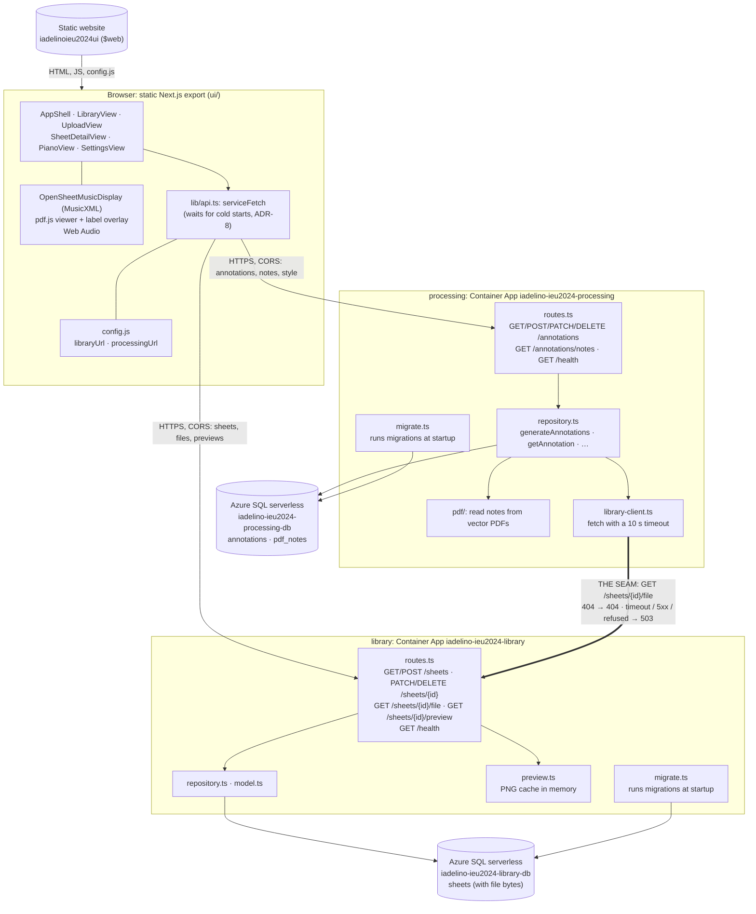

# Architecture

## Before: the Assignment 1 monolith

One Node.js process served the UI and the API. The two domains were folders in `lib/`, shared one SQLite file, and met at one function call, `readSheetFile(id)` (ADR-2).

## After: two services and a static UI (Assignment 2)

The seam is where ADR-2 put it (ADR-6). Each service has its own container and its own database, and the only server-side call across the seam is processing fetching a sheet's file from library. The browser calls both services directly. Names are the Azure ones; locally the same containers run in `docker-compose.yml` (UI on `:8080`, library on `:8001`, processing on `:8002`, one SQL Server with both databases).

What changed from the monolith:

| Monolith | Split system |
| --- | --- |
| `readSheetFile(id)`, a function call | `GET /sheets/{id}/file` over HTTP, with a timeout and a designed 503 |
| one SQLite file, `annotations.sheet_id` a foreign key to `sheets` | one database per service, `sheet_id` a plain id (ADR-7) |
| `DELETE /api/sheets/[id]` deleted annotations and the sheet | the UI deletes the sheet in library, then the annotation in processing (best effort) |
| uploads and previews on the local disk | file bytes in `sheets.file_bytes`, previews in memory only |
| schema created on first boot | numbered migrations, applied at startup (ADR-7) |
| scanned PDFs read with Audiveris | not on Azure: scans answer 503 (ADR-10) |
