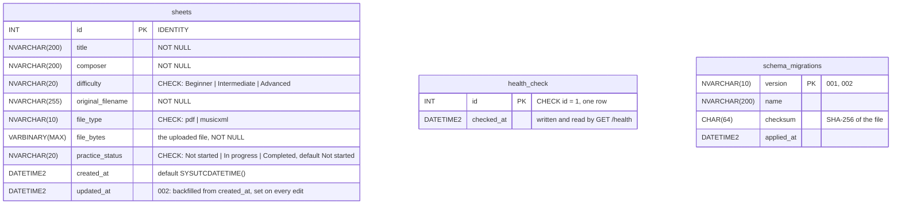
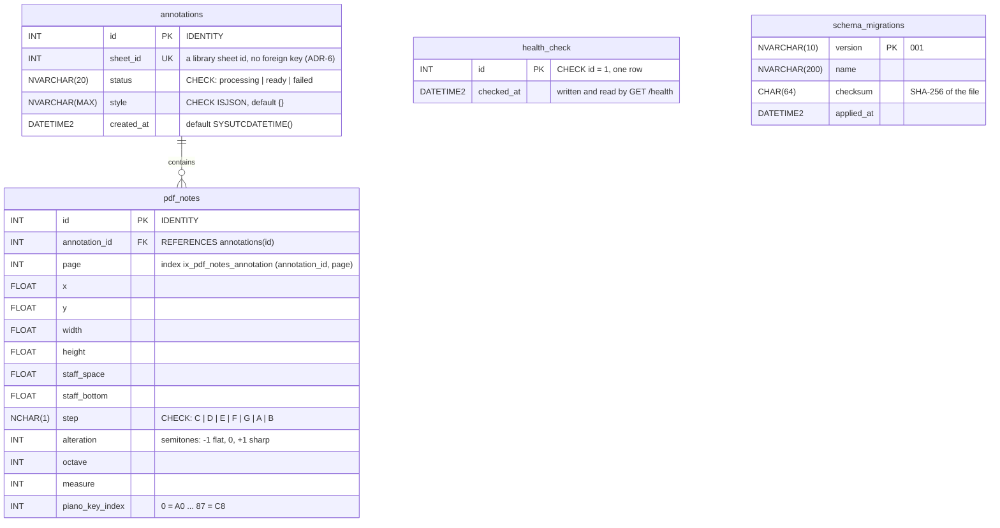
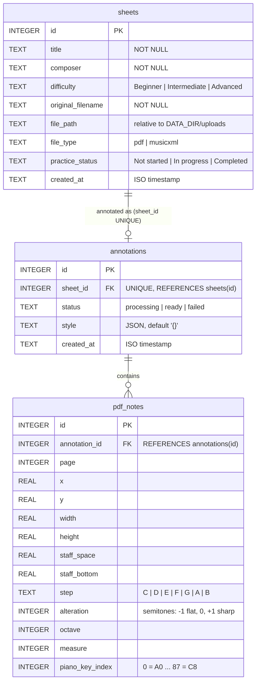

# Databases

Each service owns one Azure SQL database (in compose, one SQL Server with two databases) and creates its tables only through its own migrations (ADR-7). These diagrams match `services/library/migrations/` (001 and 002) and `services/processing/migrations/` (001). Each service user can only open its own database, so there are no foreign keys between them: `annotations.sheet_id` refers to a library sheet by value.

## library: `iadelino-ieu2024-library-db`

## processing: `iadelino-ieu2024-processing-db`

## Before: the Assignment 1 SQLite database

One file, `$DATA_DIR/pianogo.db`, with all three tables and a real foreign key across the domains. Uploaded files were on disk, referenced by `file_path`.

