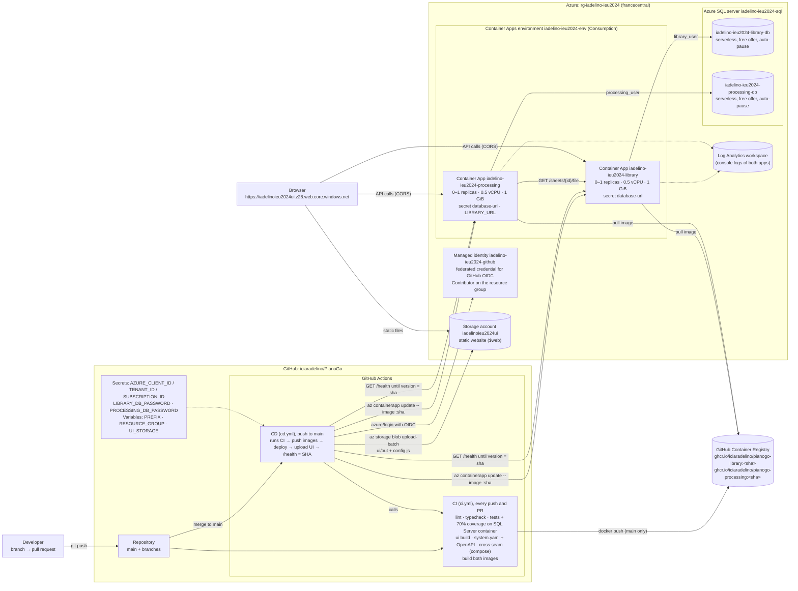

# Deployment

Every resource is in the resource group `rg-iadelino-ieu2024` (region `francecentral`) of my Azure for Students subscription, created once by `infra/setup-azure.sh`. After that, only the pipeline changes them (ADR-8, ADR-9).

| Resource | Name | Billing |
| --- | --- | --- |
| Container Apps environment | `iadelino-ieu2024-env` | Consumption: per vCPU-second and GiB-second while a replica runs, with a monthly free grant |
| Container Apps | `iadelino-ieu2024-library`, `iadelino-ieu2024-processing` | as above, scale to zero |
| Azure SQL server | `iadelino-ieu2024-sql` | no charge on its own |
| Azure SQL databases | `iadelino-ieu2024-library-db`, `iadelino-ieu2024-processing-db` | serverless free offer: free up to its monthly limit, auto-pause after 60 idle minutes |
| Storage account (static website) | `iadelinoieu2024ui` | per GB stored and per request |
| Managed identity | `iadelino-ieu2024-github` | free |
| Log Analytics workspace | created with the environment | per GB ingested, first 5 GB a month free |
| Image registry | `ghcr.io/iciaradelino` (GitHub) | free for public images |
